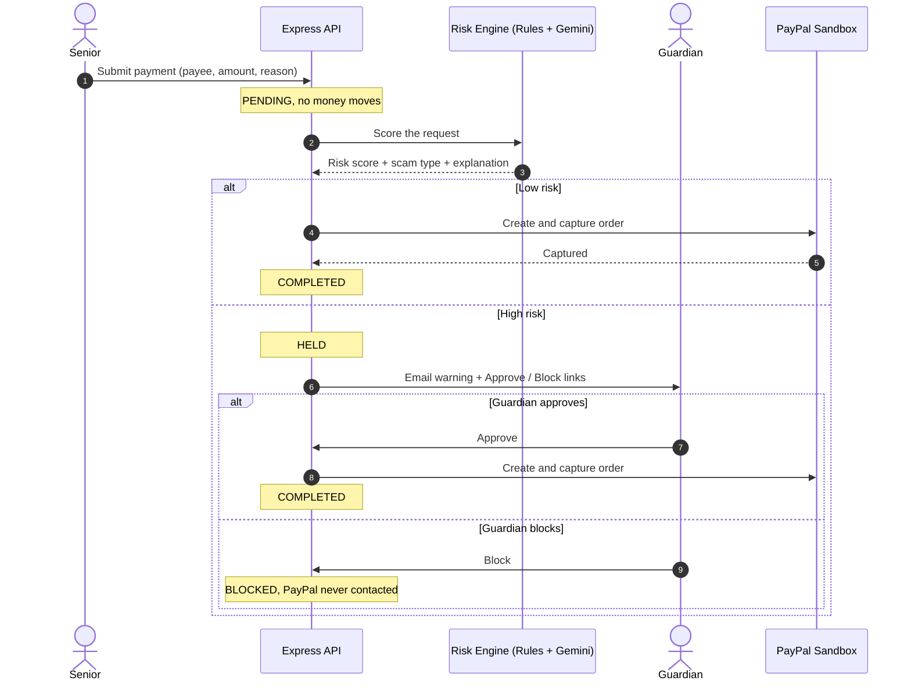
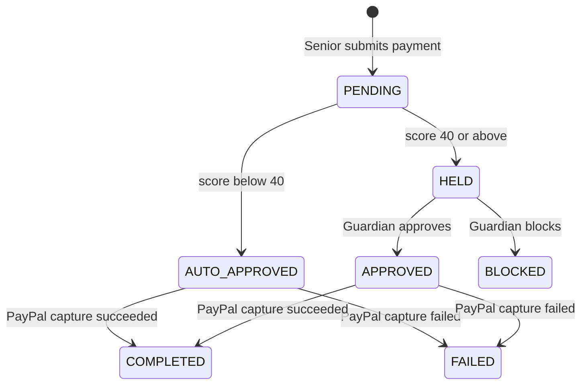

# 🛡️ Family Guardian

**AI-assisted payment protection for older adults.** Risky payments are held, scored by rules plus an LLM, and sent through PayPal only after a trusted family member approves.

Built for the [PayPal AI Hackathon](https://paypalaihackathon.devpost.com/).

[](LICENSE)
[](https://developer.paypal.com)
[](https://aistudio.google.com)
[](#-tests)

| | |
|---|---|
| 🌐 **Live demo** | https://family-guardian-wjks.vercel.app |
| 🎬 **Demo video** | https://youtu.be/5FJpoH70sJI |
| 💻 **Source** | https://github.com/kshitijpachpande12-max/Family-Guardian |

> **Sandbox only.** This project uses the PayPal **Sandbox** and Mailtrap's test inbox. No real money moves and no real emails are sent.

---

## 🚨 The problem

Older adults lose large sums to payment scams:

- **Impersonation scams:** a caller claims a grandchild is in jail or hurt and needs money now.
- **Tech-support and refund scams:** pop-ups push the victim to pay or to install remote-access tools.
- **Authority and secrecy threats:** fake tax, police or utility notices that say "don't tell your family."

By the time family finds out, the money is usually gone.

## 💡 The solution

Family Guardian puts a **guardian** (a trusted family member) between a senior's payment request and the money actually moving.

1. The senior submits a payment: payee, amount and a short reason.
2. The backend creates the request in `PENDING`. **No money moves.**
3. A hybrid risk engine scores it: deterministic rules plus a Gemini analysis of the context.
4. **Low risk** is approved automatically and captured through PayPal.
5. **High risk** is `HELD`. The guardian gets an email with a plain-language warning and one-click Approve / Block links.
6. Only an approved payment ever reaches PayPal. A blocked one never touches it.



---

## ✨ Features

- **Hybrid risk engine:** rule-based checks plus Gemini returning structured JSON (risk, scam type, explanation).
- **Graceful fallback:** if the LLM is slow or unavailable, a 5-second timeout falls back to the rule engine so a payment never hangs.
- **Payment state machine:** only valid transitions are allowed, so a held or blocked payment can't be paid by accident.
- **PayPal Sandbox Orders v2:** OAuth client-credentials flow with token caching, create and capture, and a unique `PayPal-Request-Id` per payment as an idempotency key.
- **One-click guardian actions:** signed, short-lived (24 h) JWT links in the alert email.
- **Two role-based portals:** a large, simple senior portal and a guardian console with history and an audit trail.
- **Audit trail:** every decision is recorded, including whether PayPal ran live in the sandbox or in the built-in simulator.

---

## ⚙️ Payment state machine



`BLOCKED`, `COMPLETED` and `FAILED` are terminal. Invalid transitions are rejected in `server/src/lib/stateMachine.js` and covered by unit tests.

---

## 🧠 How the risk score works

| Layer | File | What it does |
|---|---|---|
| Rules | `ruleScorer.js` | Instant pattern checks for gift cards, crypto, wire transfers, tax or police threats, remote-access tools, urgency and secrecy language, new payees and unusual amounts. |
| LLM | `geminiScorer.js` | Reads the free-text reason and context and returns JSON: `{ risk, scam_type, explanation }`, enforced through a response schema. |
| Combiner | `riskEngine.js` | Merges both results into one score. At or above the threshold the payment is held. |

Rules are fast, free and predictable. The LLM catches subtle coercion that keyword rules miss, and writes an explanation a non-technical person can understand. The guardian, not the AI, makes the final call on risky payments.

---

## 🧰 Tech stack

| Area | Technology |
|---|---|
| Frontend | React 19, Vite, React Router, Axios |
| Backend | Node.js, Express 5, Mongoose, JWT, Nodemailer |
| Database | MongoDB Atlas |
| AI | Google Gemini (model set with `GEMINI_MODEL`) |
| Payments | PayPal Sandbox REST API, Orders v2 |
| Email | Mailtrap (sandbox SMTP) |
| Testing | Jest |
| Hosting | Vercel |

---

## 📁 Project structure

```
Family-Guardian/
├── client/                     # React + Vite frontend
│   └── src/
│       ├── pages/              # Landing, Login, Register, SeniorPortal, GuardianConsole
│       ├── components/         # Navbar
│       ├── context/            # AuthContext
│       └── api/client.js       # Axios instance (uses VITE_API_URL)
├── server/
│   ├── src/
│   │   ├── index.js            # Express app
│   │   ├── routes/             # auth.js, payments.js
│   │   ├── models/             # User.js, Payment.js
│   │   ├── lib/                # stateMachine, ruleScorer, geminiScorer,
│   │   │                       # riskEngine, paypalClient, emailService
│   │   ├── middleware/auth.js  # JWT auth and role checks
│   │   ├── data/               # evaluationScenarios.json
│   │   └── scripts/            # seed.js, evaluate.js
│   └── __tests__/              # Jest tests
├── .env.example
└── LICENSE
```

---

## 🔌 API overview

| Method | Endpoint | Role | Purpose |
|---|---|---|---|
| POST | `/api/auth/register` | public | Create a senior or guardian account |
| POST | `/api/auth/login` | public | Log in, returns a JWT |
| GET | `/api/auth/me` | any | Current user |
| POST | `/api/payments` | senior | Submit a payment request |
| GET | `/api/payments` | any | List payments |
| GET | `/api/payments/:id` | any | Payment details and audit log |
| POST | `/api/payments/:id/approve` | guardian | Approve a held payment |
| POST | `/api/payments/:id/block` | guardian | Block a held payment |
| GET | `/api/payments/action?token=…` | token | One-click approve or block from email |

---

## 🚀 Run it locally

### Prerequisites
- Node.js 18 or newer
- A MongoDB database (Atlas free tier or local)
- A free [PayPal Developer](https://developer.paypal.com) sandbox app
- A [Gemini API key](https://aistudio.google.com)
- A free [Mailtrap](https://mailtrap.io) inbox

### 1. Clone and install
```bash
git clone https://github.com/kshitijpachpande12-max/Family-Guardian.git
cd Family-Guardian

cd server && npm install
cd ../client && npm install
```

### 2. Configure environment variables
Copy `.env.example` to `server/.env` and fill in your values.

| Variable | Description |
|---|---|
| `PORT` | API port (default `5000`) |
| `MONGODB_URI` | MongoDB connection string |
| `JWT_SECRET` | Long random string for signing tokens |
| `PAYPAL_CLIENT_ID` / `PAYPAL_CLIENT_SECRET` | PayPal **sandbox** app credentials |
| `PAYPAL_API_BASE` | `https://api-m.sandbox.paypal.com` |
| `PAYPAL_MOCK` | `true` to use the built-in simulator, `false` for the live sandbox |
| `GEMINI_API_KEY` / `GEMINI_MODEL` | Gemini key and model name |
| `MAILTRAP_HOST` / `MAILTRAP_PORT` / `MAILTRAP_USER` / `MAILTRAP_PASS` | Mailtrap SMTP settings |
| `CLIENT_URL` | Frontend URL (`http://localhost:5173` locally) |
| `API_BASE_URL` | Public backend URL, used to build the email action links (`http://localhost:5000` locally) |

For the frontend, set `VITE_API_URL` (for example `http://localhost:5000/api`).

> Never commit `.env`. It is listed in `.gitignore`.

### 3. Seed demo data
```bash
cd server
npm run seed
```

| Role | Email | Password |
|---|---|---|
| Senior | `eleanor@guardian.demo` | `password123` |
| Guardian | `david@guardian.demo` | `password123` |

### 4. Start both apps
```bash
# Terminal 1
cd server && npm run dev

# Terminal 2
cd client && npm run dev
```
Open http://localhost:5173.

---

## 🎬 Try the demo flow

1. Log in as **Eleanor** (senior) and submit a normal payment, such as a small amount to a known payee. It is auto-approved and captured in the PayPal sandbox.
2. Submit an urgent request, for example paying a large sum in gift cards and being told not to tell the family. It is **held** with an AI explanation.
3. Open your Mailtrap inbox and read the guardian alert.
4. Click **Block** (or **Approve**) in the email, or log in as **David** (guardian) and use the console.
5. Check the payment's audit log for the decision and whether PayPal ran live or in the simulator.

---

## 🧪 Tests

```bash
cd server
npm test            # Jest
npm run evaluate    # 20-scenario fraud-detection benchmark
```

- **53 unit tests** cover the state machine, rule scorer, PayPal client and email action links.
- `authIntegration.test.js` is an integration test that needs a reachable MongoDB (`MONGODB_URI`).

### Evaluation
`npm run evaluate` runs the engine over **20 hand-written scenarios** in `server/src/data/evaluationScenarios.json`: 10 scam attempts and 10 legitimate household payments.

| Metric | Result |
|---|---|
| Scams caught | 10 / 10 |
| False alarms | 0 / 10 |
| Overall accuracy | 20 / 20 |

> These scenarios were written by the project author, so the numbers show the engine behaves as designed on known cases. They are not a measure of performance against real-world fraud.

---

## ☁️ Deployment (Vercel)

Two Vercel projects from the same repo:

1. **Backend:** Root Directory `server`, framework preset *Other*. `server/api/index.js` exports the Express app and `server/vercel.json` rewrites all routes to it. Add the environment variables above, including `API_BASE_URL` (the backend's own URL) and `CLIENT_URL` (the frontend URL).
2. **Frontend:** Root Directory `client` (Vite is detected automatically). Set `VITE_API_URL` to `https://<backend-url>/api`. `client/vercel.json` rewrites routes to `index.html` so React Router pages survive a refresh.
3. In MongoDB Atlas, allow network access from `0.0.0.0/0`, because Vercel's IP addresses change.
4. Redeploy after changing any environment variable.

---

## 🔒 Security notes

- Secrets live only in environment variables.
- Passwords are hashed and API access uses JWTs with role checks; a guardian can act only on payments of the senior they are linked to.
- Action links in emails are signed and expire after 24 hours.
- Each payment carries a unique idempotency key so a retry or double click cannot charge twice.

## ⚠️ Known limitations

- **Sandbox only:** no real payments, and guardian emails land in Mailtrap, not real inboxes.
- **GET-based email links:** some email scanners pre-open links, which could trigger an action by accident. A confirmation step (POST) is the planned fix.
- **Rule and LLM limits:** scam language evolves, and an LLM can be wrong. That is why a human guardian decides on every held payment.
- **Serverless time limits:** scoring and the PayPal call run in a single request, which can be slow on cold starts.

## 🗺️ What's next

- PayPal webhooks with signature verification for payment status updates
- SMS or push alerts for guardians
- Warnings in the senior's own language
- Trusted-payee lists and per-senior spending limits
- A confirmation page for email actions, to avoid accidental scanner triggers

---

## 📄 License

Released under the [MIT License](LICENSE).
