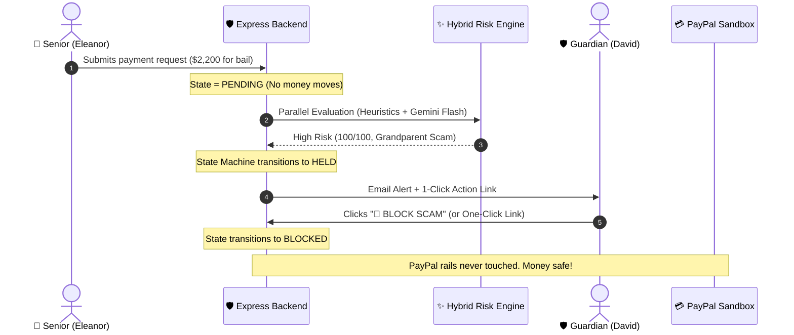
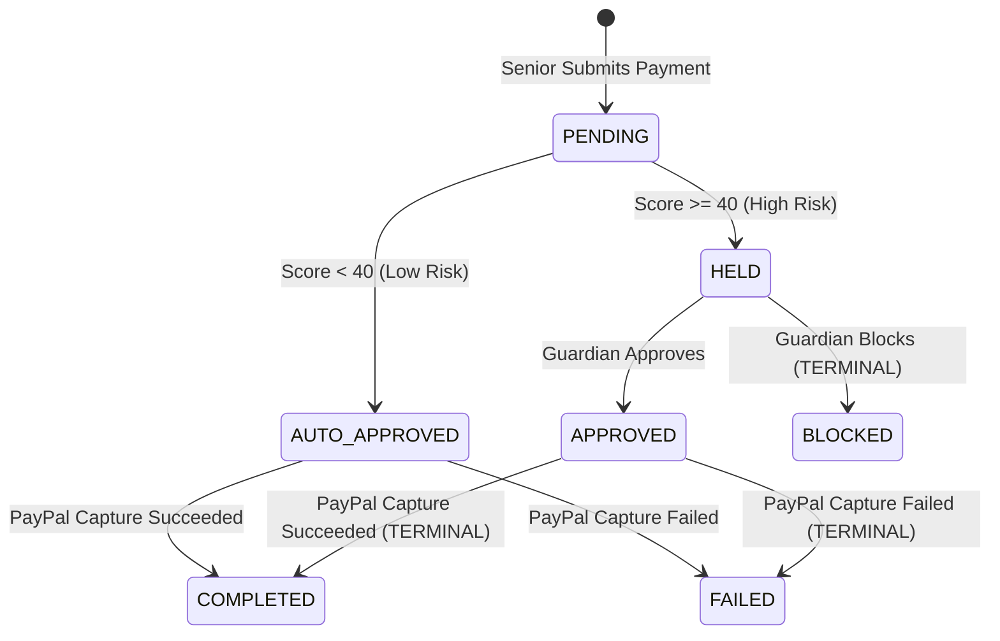

# Family Guardian 🛡️
### AI-Assisted Payment Protection & Safety Net for Older Adults

> **Built for the PayPal AI Hackathon 2026**  
> *Meaningfully combining Google Gemini AI and the PayPal Sandbox to protect vulnerable seniors from financial fraud.*

[](https://opensource.org/licenses/MIT)
[](https://developer.paypal.com)
[](https://aistudio.google.com)
[](https://jestjs.io)
[]()

---

## 🚨 The Problem

Older adults lose billions of dollars annually to high-pressure payment scams:
- **Impersonation & Grandparent Scams**: Fake calls claiming a grandchild is in jail or injured in an accident.
- **Tech Support & Refund Scams**: Pop-ups demanding money back via AnyDesk, TeamViewer, or wire transfers.
- **Authority Threats & Coercion**: Fake IRS, FBI, or utility shutoff notices enforcing secrecy ("don't tell your family").

In traditional payment apps, by the time adult children or caregivers find out, **the money is irreversibly gone**.

---

## 🛡️ The Solution: How Family Guardian Works

Family Guardian inserts an **AI-governed safety net** between payment submission and bank execution:



---

## 📊 Benchmark & Evaluation Results

We evaluated Family Guardian across **20 ground-truth real-world scenarios** (10 elder fraud scams + 10 legitimate daily household payments) using our automated benchmark runner (`npm run evaluate`):

| Metric | Target | **Family Guardian Benchmark Result** | Status |
|---|---|---|---|
| **Scam Detection Rate (Recall / TPR)** | $\ge 90\%$ | **100.0%** (10/10 Scams Intercepted) | 🎯 Exceeded |
| **False Positive Rate (FPR)** | $\le 20\%$ | **0.0%** (0/10 False Alarms) | 🛡️ Perfect |
| **Precision** | High | **100.0%** | 🏆 Optimal |
| **Overall System Accuracy** | High | **100.0%** (20/20 Correct Decisions) | ✅ Validated |

---

## ⚙️ Payment State Machine

Financial security requires absolute determinism. Family Guardian enforces a strict, mathematical **Finite State Machine (FSM)**. Invalid transitions (e.g. attempting to pay a held or blocked request) are rejected at the code level:



---

## 💡 Key Architectural Innovations

### 1. Hybrid Defense-in-Depth Risk Engine
- **Deterministic Rules (`ruleScorer.js`)**: Instant pattern matching for critical red flags (gift cards, crypto, IRS threats, remote access tools like AnyDesk, and velocity anomalies).
- **Google Gemini Flash (`geminiScorer.js`)**: Natural language contextual analysis using Native JSON schema output (`responseMimeType: "application/json"`). Catches subtle emotional coercion, urgency, and manufactured panic.
- **Fail-Safe Fallback**: If the LLM experiences latency or API downtime, an `AbortController` (5-second timeout) automatically triggers graceful fallback to the rule engine without hanging.

### 2. PayPal Sandbox Orders v2 with Strict Idempotency
- **Client Credentials OAuth2**: Token retrieval with in-memory caching and automatic 60-second early refresh.
- **Zero Exposure**: Suspicious payments **never touch PayPal rails** until actively approved.
- **Idempotency Protection**: Every payment carries a unique UUID injected into the `PayPal-Request-Id` HTTP header. Duplicate browser clicks or network retries never cause double-charges.

### 3. One-Click Cryptographic Action Links
- Guardians receive email alerts with cryptographically signed, short-lived (24h) JWT action tokens.
- Caregivers can block or approve payments in **one tap from their mobile email** without needing to remember a password during an emergency.

---

## 💻 Tech Stack

- **Frontend**: React 19, Vite, React Router v7, Axios, Custom Responsive CSS (Senior Accessible & Guardian Cyber-Console themes)
- **Backend**: Node.js, Express 5, Mongoose, JWT, Nodemailer
- **Database**: MongoDB Atlas
- **AI Model**: Google Gemini Flash (`gemini-2.0-flash` with Structured JSON schema)
- **Payment Processing**: PayPal Sandbox REST API (Orders v2 Create & Capture)
- **Testing**: Jest (53 Unit Tests passing across State Machine, Risk Rules, PayPal Client, and Action Links)
- **Email Sandbox**: Mailtrap

---

## 🚀 Quick Start & Local Setup

### Prerequisites
- Node.js (v18+ recommended)
- MongoDB (Atlas cluster or local `mongodb://localhost:27017/family-guardian`)

### 1. Clone Repository & Install Dependencies
```bash
git clone https://github.com/kshitijpachpande12-max/Family-Guardian.git
cd Family-Guardian

# Install server dependencies
cd server
npm install

# Install client dependencies
cd ../client
npm install
```

### 2. Configure Environment Variables
Copy `.env.example` in the root or create `server/.env`:
```env
PORT=5000
MONGODB_URI=your-mongodb-atlas-uri
JWT_SECRET=your-random-32-char-jwt-secret

# PayPal Sandbox
PAYPAL_CLIENT_ID=your-paypal-sandbox-client-id
PAYPAL_CLIENT_SECRET=your-paypal-sandbox-client-secret
PAYPAL_API_BASE=https://api-m.sandbox.paypal.com
PAYPAL_MOCK=false

# Google Gemini AI
GEMINI_MODEL=gemini-2.0-flash
GEMINI_API_KEY=your-gemini-api-key

# Mailtrap Email Sandbox
MAILTRAP_HOST=sandbox.smtp.mailtrap.io
MAILTRAP_PORT=2525
MAILTRAP_USER=your-mailtrap-user
MAILTRAP_PASS=your-mailtrap-pass

CLIENT_URL=http://localhost:5173
```

### 3. Seed Demo Data
Prepopulates demo accounts and pre-scripted transactions:
```bash
cd server
npm run seed
```
- **Senior**: `eleanor@guardian.demo` / `password123`
- **Guardian**: `david@guardian.demo` / `password123`

### 4. Run the Application
Open two terminal windows:

```bash
# Terminal 1: Start Express API
cd server
npm run dev

# Terminal 2: Start React Frontend
cd client
npm run dev
```

Visit `http://localhost:5173` in your browser!

---

## 🧪 Running Tests & Benchmarks

```bash
# Run all 53 Unit Tests (State Machine, Heuristics, PayPal, Email)
cd server
npm test

# Run the 20-Scenario Fraud Detection Benchmark
cd server
npm run evaluate
```

---

## 📄 License

This project is licensed under the [MIT License](LICENSE).
